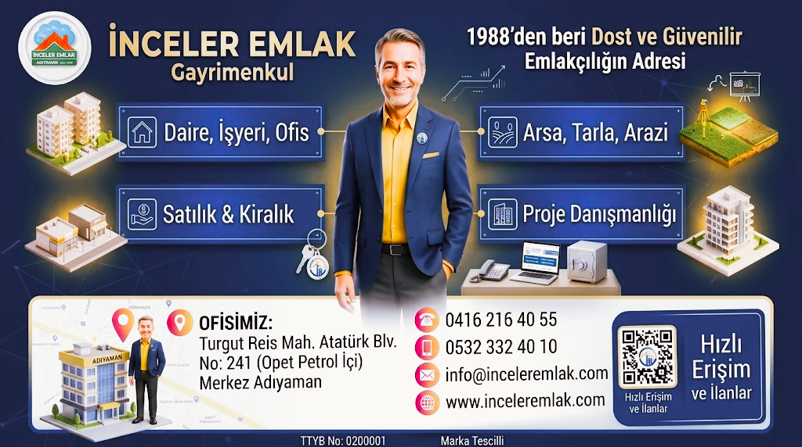

  <!-- Tıklanabilir Kurumsal Banner Görseli -->
  

  
  
  

---

## 🌍 About İnceler Emlak & Tech Vision (English)
Established in 1988, **İnceler Emlak®** is the leading real estate and property management agency in Adıyaman, Turkey. We merge decades of market expertise with modern **PropTech** solutions. Our digital infrastructure operates on a custom **PHP backend**, fully integrated with the Turkish Ministry of Commerce's **EİDS** (Electronic Listing Verification System) via cURL API and AJAX modals. We also utilize **GitHub Actions** for automated CI/CD pipelines and cron-based synchronization with the Google Business Profile API to ensure real-time local SEO and listing updates across 33+ neighborhoods.

---

## 🏢 İnceler Emlak® | Kurumsal Kimlik & Yasal Künye
1988 yılından bu yana Adıyaman ve çevresinde gayrimenkul yatırım danışmanlığı, ekspertiz ve kiralama süreçlerinde şeffaflığın ve güvenin simgesiyiz.

* **Slogan:** *1988'den beri Dost ve Güvenilir Emlakçılığın Adresi*
* **T.C. Ticaret Bakanlığı TTYB No:** 0200001
* **TÜRKPATENT Marka Tescil No:** 2021/089859 & 2022/043398 (İnceler® & İnceler Emlak™)
* **Vergi Dairesi & VKN:** Adıyaman V.D. | 4760452008
* **Merkez Ofis:** Turgut Reis Mah. Atatürk Blv. No: 241 (Opet Petrol İçi) / Merkez, Adıyaman

---

## 💻 Teknolojik Altyapı & Ar-Ge Odaklı Yaklaşımımız
Müşterilerimize kesintisiz, güvenli ve hızlı hizmet sunmak için operasyonlarımızı özel geliştirilmiş yazılım mimarimizle yönetiyoruz:

1. **Özel PHP Portal Mimarisi:** İlan ve portföy yönetimimizi yüksek performanslı, SEO/GEO optimize edilmiş kendi özel PHP altyapımızla sağlıyoruz.
2. **EİDS (Elektronik İlan Doğrulama Sistemi) API Entegrasyonu:** T.C. Ticaret Bakanlığı standartlarına tam uyum çerçevesinde; IP izinli EİDS yetkilendirmesi, cURL API client scriptleri ve front-end AJAX doğrulama modülleri ile gerçek zamanlı güvenli ilan yayınlıyoruz.
3. **Otomatize İş Akışları (GitHub Actions):** Geliştirdiğimiz `gbp-sync.yml` CI/CD pipeline'ı ve `cron/sync_google_business.php` otomasyonu ile portföy verilerimizi Google Business Profile (Yerel SEO) API'sine otomatik ve anlık olarak senkronize ediyoruz.

---

## 📌 Hizmet ve Analiz Bölgelerimiz
Adıyaman Merkez başta olmak üzere geniş bir bölgesel veritabanına ve aktif saha operasyonuna sahibiz:
* **Adıyaman Merkez & Altınşehir** (Modern konut, ticari yapılar ve öğrenci segmenti)
* **İndere (Zey) Bölgesi** (Gelişen yeni yerleşim projeleri)
* **Karapınar, Bahçelievler, Turgutreis, Sümerevler, Alıtaşı & Yeşilyurt**
* **Kahta, Besni, Gölbaşı, Tut, Samsat** (Kapsamlı ilçe, tarım arazisi ve arsa değerleme süreçleri)

---

## 👨‍💻 Yönetim ve Teknik Ekip

* **Süleyman İnce** – Kurucu Broker & İşletme Sahibi
* **Emin Yılmaz** – Gayrimenkul Danışmanı *(Portföy & Kiralama Süreçleri)* 
* **Ömer Öztürk** – Gayrimenkul Yatırım Danışmanı *(Portföy & Satış Süreçleri)*
* **Mustafa İnce** – İdari İşler & Kurumsal İletişim *(Bakanlık Uyumluluğu & EİDS İdari Yönetimi)*
* **Yusuf Salih Altun** – Teknik Koordinatör *(Yazılım Altyapısı, API & EİDS Entegrasyonu)*

---

## 📞 İletişim

* **Telefon (Ofis):** +90 (416) 216 40 55
* **E-Posta:** [info@inceleremlak.com](mailto:info@inceleremlak.com)
* **Web Portal:** [www.inceleremlak.com](https://www.inceleremlak.com)

  © 1988 - 2026 İnceler Emlak®. Tüm hakları saklıdır.

